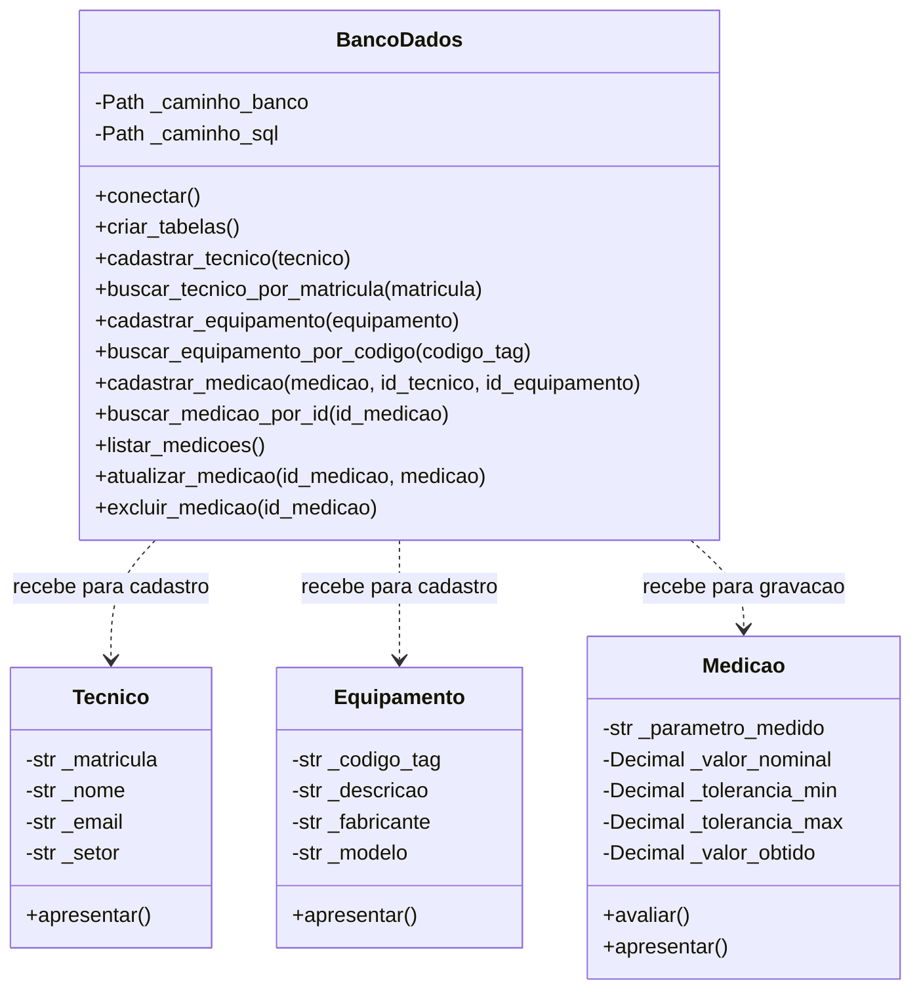
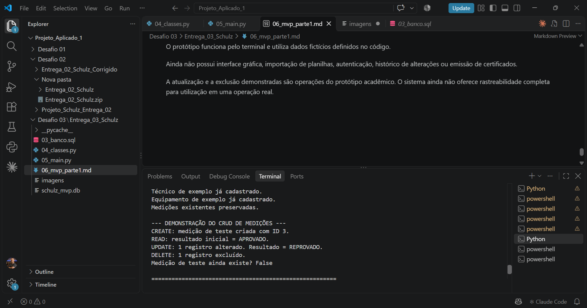
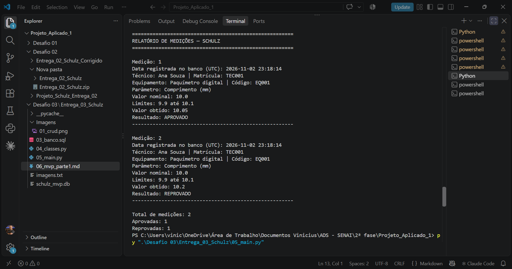

# MVP — Parte 1: Sistema de Medições Schulz

## 1. Objetivo

Desenvolver um protótipo em Python para cadastrar técnicos e equipamentos,
registrar medições e consultar seus resultados.

O sistema compara o valor obtido com o intervalo permitido e classifica
a medição como APROVADO ou REPROVADO. Os dados são armazenados no SQLite.

A demonstração utiliza dados fictícios.

## 2. Organização dos arquivos

| Arquivo | Finalidade |
|---|---|
| 03_banco.sql | Define as tabelas e os relacionamentos do banco. |
| 04_classes.py | Contém as classes, as validações e as operações no banco. |
| 05_main.py | Executa os exemplos, demonstra o CRUD e apresenta o relatório. |
| 06_mvp_parte1.md | Documenta a implementação e sua validação. |
| schulz_mvp.db | Armazena os dados cadastrados. |
| Relatorio_Entrega_03.pdf | Apresenta o relatório consolidado da entrega. |
| Imagens/01_crud.png | Registra a demonstração do CRUD. |
| Imagens/02_relatorio.png | Registra o relatório apresentado no terminal. |

## 3. Organização das classes

### 3.1 Tecnico

Representa o profissional responsável pelas medições.

- Atributos: matrícula, nome, e-mail e setor.
- Validação: os campos devem conter textos preenchidos.
- Tratamento: remove espaços no início e no final dos textos.
- Método apresentar(): retorna o nome e a matrícula.

### 3.2 Equipamento

Representa o instrumento associado às medições.

- Atributos: código, descrição, fabricante e modelo.
- Validação: os campos devem conter textos preenchidos.
- Tratamento: remove espaços no início e no final dos textos.
- Método apresentar(): retorna a descrição e o código.

A descrição do objeto é gravada na coluna nome_equipamento do banco.

### 3.3 Medicao

Representa os valores utilizados na avaliação de uma medição.

- Atributos: parâmetro medido, valor nominal, tolerância inferior,
  tolerância superior e valor obtido.
- Validações: parâmetro preenchido e números finitos.
- Tratamento: as tolerâncias são convertidas em magnitudes positivas.
- Método avaliar(): retorna APROVADO ou REPROVADO.
- Método apresentar(): apresenta os valores e o resultado.

As propriedades limite_minimo e limite_maximo calculam os limites
permitidos a partir do valor nominal e das tolerâncias.

### 3.4 BancoDados

Centraliza o acesso ao SQLite.

Responsabilidades:

- Abrir e fechar conexões.
- Ativar a verificação das chaves estrangeiras em cada conexão.
- Executar o script de criação das tabelas.
- Cadastrar e consultar técnicos e equipamentos.
- Cadastrar, consultar, atualizar e excluir medições.
- Consultar medições com os dados do técnico e do equipamento.

Os caminhos do banco e do script SQL são definidos a partir da pasta
do arquivo 04_classes.py.

### 3.5 Diagrama das classes

O diagrama apresenta os principais atributos, métodos e dependências
das classes implementadas. As propriedades de leitura e os métodos
auxiliares de validação foram omitidos para facilitar a leitura.



O sinal de menos identifica os atributos internos por convenção.
O sinal de mais identifica os métodos públicos apresentados.

As setas indicam dependências: BancoDados recebe os objetos e utiliza
seus dados nas operações SQL.

No banco, cada medição está vinculada a um técnico e a um equipamento.
Esses vínculos são registrados por identificadores e chaves estrangeiras.
As setas do diagrama de classes não representam essas chaves estrangeiras.

### 3.6 Identificadores dos registros

Nesta versão, os identificadores são gerados pelo SQLite:

- id_tecnico identifica o técnico.
- id_equipamento identifica o equipamento.
- id_medicao identifica a medição.

As classes Tecnico e Equipamento ainda não armazenam esses IDs como
atributos. O programa recupera os identificadores nas consultas ao banco
e os utiliza para vincular cada medição aos cadastros correspondentes.

## 4. Aplicação da orientação a objetos

O sistema utiliza classes para separar as responsabilidades.

Tecnico e Equipamento representam os cadastros. Medicao concentra
a regra de avaliação. BancoDados executa as operações SQL.
O arquivo 05_main.py organiza a demonstração e apresenta os resultados.

Os atributos iniciados com sublinhado são considerados internos
por convenção do Python. Isso não impede seu acesso pela linguagem.

As propriedades com @property permitem consultar os valores sem
disponibilizar um setter público.

As validações são realizadas na criação dos objetos, antes do envio
dos dados ao banco.

Não foram utilizadas herança e polimorfismo nesta versão.

## 5. Regra de avaliação

O intervalo permitido é calculado da seguinte forma:

- Limite mínimo = valor nominal − tolerância inferior.
- Limite máximo = valor nominal + tolerância superior.

A medição é APROVADA quando o valor obtido está dentro desse intervalo,
incluindo os limites. Fora dele, é REPROVADA.

Exemplo:

| Valor nominal | Tolerâncias | Valor obtido | Resultado |
|---|---|---|---|
| 10,00 mm | 0,10 mm para cada lado | 10,05 mm | APROVADO |
| 10,00 mm | 0,10 mm para cada lado | 10,20 mm | REPROVADO |

Nos dois casos, o intervalo permitido vai de 9,90 até 10,10 mm.

A classe Medicao utiliza Decimal nos cálculos. No SQLite, as colunas
numéricas são do tipo REAL, que possui precisão aproximada.

Os valores numéricos informados como texto devem utilizar ponto decimal,
como "10.05".

O código utiliza abs() nas tolerâncias. Assim, uma tolerância negativa
é convertida em positiva, em vez de ser rejeitada. Essa é a regra adotada
neste protótipo.

## 6. Persistência e relacionamentos

O banco possui três tabelas:

| Tabela | Chave primária | Finalidade |
|---|---|---|
| tecnico | id_tecnico | Armazenar os profissionais responsáveis. |
| equipamento | id_equipamento | Armazenar os instrumentos de medição. |
| medicao | id_medicao | Armazenar os valores e resultados das medições. |

Cada medição está associada a um técnico e a um equipamento por meio
de chaves estrangeiras.

Um técnico pode estar associado a várias medições.
Um equipamento também pode estar associado a várias medições.

A matrícula do técnico e o código do equipamento são únicos.
O resultado da medição aceita somente APROVADO ou REPROVADO.

As chaves estrangeiras impedem a exclusão de um técnico ou equipamento
que esteja vinculado a uma medição.

O relatório utiliza JOIN para reunir as informações das três tabelas.

A data é preenchida pelo banco com CURRENT_TIMESTAMP e apresentada
no relatório como UTC.

### 6.1 Nomenclatura das tabelas

O roteiro da AV03 menciona tecnicos, equipamentos e medicoes.
Nesta implementação, foram utilizados os nomes no singular:
tecnico, equipamento e medicao.

O script SQL, as consultas e a documentação utilizam esses mesmos nomes.
A diferença é de nomenclatura; as três entidades estão representadas.

Um banco anterior com tabelas no plural exige adaptação ou migração
para ser utilizado por este código.

## 7. Operações implementadas

| Entidade | Operações |
|---|---|
| Técnico | Cadastro e consulta por matrícula. |
| Equipamento | Cadastro e consulta por código. |
| Medição | Cadastro, consulta, atualização e exclusão. |

O CRUD completo foi implementado para as medições:

- CREATE: cadastra uma medição.
- READ: consulta uma medição pelo ID ou lista o relatório.
- UPDATE: altera os valores e recalcula o resultado.
- DELETE: exclui a medição pelo ID.

Os comandos utilizam parâmetros com ?, evitando a montagem do SQL
pela concatenação dos valores.

A consulta do relatório relaciona as tabelas medicao, tecnico
e equipamento por meio de JOIN.

## 8. Tratamento de erros

O programa trata os seguintes problemas:

| Exceção | Situação tratada |
|---|---|
| ValueError | Dados inválidos na criação dos objetos. |
| sqlite3.IntegrityError | Violação das regras do banco. |
| sqlite3.Error | Outras falhas nas operações SQL. |
| OSError | Problemas de acesso aos arquivos. |
| RuntimeError | Falhas identificadas na demonstração do CRUD. |

Nas operações de gravação, commit confirma as alterações.
Em caso de erro SQL, rollback desfaz alterações ainda não confirmadas
na conexão.

As conexões são fechadas no bloco finally, inclusive quando ocorre
um erro durante a operação.

O programa principal apresenta uma mensagem no terminal quando
uma das exceções previstas é identificada.

## 9. Fluxo de execução

1. O programa prepara o banco e suas tabelas.
2. Cria os objetos de técnico e equipamento de exemplo.
3. Consulta os cadastros e insere somente os que não existem.
4. Recupera os identificadores do técnico e do equipamento.
5. Se não houver medições, cadastra dois exemplos iniciais.
6. Cria uma medição temporária para demonstrar o CRUD.
7. Consulta essa medição e atualiza seus valores.
8. Exclui a medição temporária e verifica sua ausência.
9. Consulta as medições restantes com JOIN.
10. Exibe o relatório e a quantidade de resultados de cada tipo.

## 10. Validação realizada

A execução demonstrou os seguintes resultados:

| Verificação | Resultado observado |
|---|---|
| Consulta do técnico | Ana Souza, matrícula TEC001. |
| Consulta do equipamento | Paquímetro digital, código EQ001. |
| Medição dentro do intervalo | APROVADO para 10,05 mm. |
| Medição fora do intervalo | REPROVADO para 10,20 mm. |
| Criação da medição temporária | Registro criado com identificador gerado pelo banco. |
| Consulta da medição temporária | Resultado inicial APROVADO. |
| Atualização da medição temporária | Um registro alterado para REPROVADO. |
| Exclusão da medição temporária | Um registro excluído. |
| Verificação após a exclusão | A expressão que verifica a existência retornou False. |
| Relatório final | Duas medições: uma aprovada e uma reprovada. |

O ID da medição temporária pode variar entre execuções.

O resultado False significa que a medição temporária não foi encontrada
após a exclusão. O método de consulta retorna None quando o registro
não existe.

Os tratamentos de erro estão implementados, mas as capturas abaixo
não comprovam todos os cenários de falha.

### 10.1 Evidência do CRUD



A imagem registra a criação, consulta, atualização e exclusão
de uma medição temporária.

### 10.2 Evidência do relatório



A imagem apresenta os dados das medições, do técnico e do equipamento,
além da quantidade de resultados aprovados e reprovados.

## 11. Como executar

Requisitos:

- Python 3 instalado.
- Permissão de leitura e gravação na pasta do projeto.
- Arquivo 03_banco.sql na mesma pasta dos arquivos Python.

O programa utiliza apenas bibliotecas padrão do Python.

Extraia o ZIP e abra um terminal na pasta que contém 05_main.py.

No Windows, execute:

```powershell
py 05_main.py
```

Em ambientes que utilizam o comando python3, execute:

```bash
python3 05_main.py
```

O banco schulz_mvp.db será criado caso não exista.

Em novas execuções, os cadastros de exemplo existentes são reutilizados.
As duas medições iniciais são inseridas somente quando não há medições.

A medição temporária do CRUD é criada e excluída durante a demonstração.

## 12. Limitações desta versão

O protótipo funciona pelo terminal e utiliza dados fictícios definidos
no código.

Ainda não possui:

- Interface gráfica.
- Importação de planilhas.
- Autenticação de usuários.
- Histórico de alterações.
- Emissão de certificados.
- Atualização e exclusão de técnicos e equipamentos.
- Armazenamento dos identificadores nos objetos Tecnico e Equipamento.

A atualização e a exclusão demonstradas são operações do protótipo
acadêmico. O sistema ainda não oferece rastreabilidade completa
para utilização em uma operação real.

## 13. Repositório do projeto

https://github.com/Vinicius-Souza-1/projeto-schulz-entrega-03

## 14. Integrantes

- Victor Gabriel Jaeger
- Vinicius de Assis Mendes
- Vinícius Itamar de Souza